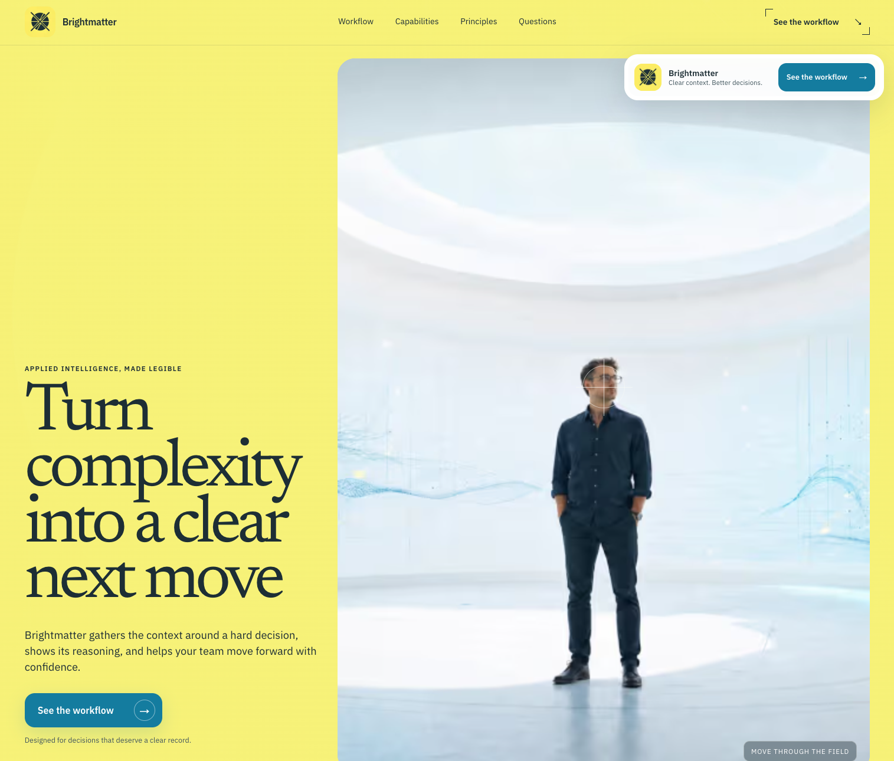

# Brightmatter AI

An original, open-source Next.js landing-page template for applied AI products. Brightmatter combines bright editorial colour fields, cinematic imagery, expressive typography, and restrained input-driven motion.



Created by Anthony Young and released under the MIT License.

## Features

- Long-form responsive landing page with an editorial mobile layout
- Typed content configuration for brand, copy, navigation, sections, metadata, and assets
- Pointer and scroll-driven grade-shift hero
- Motion-powered headline clipping, parallax, magnetic CTAs, and accordions
- Reduced-motion fallbacks and meaningful server-rendered content
- Local image and font assets with no runtime third-party requests
- Open Graph, Twitter, manifest, favicon, robots, and sitemap metadata
- Vitest, Testing Library, Playwright, and axe accessibility coverage

## Stack

- Next.js 16.2 with the App Router
- React 19 and TypeScript
- Tailwind CSS 4
- Motion 12
- Vitest and Testing Library
- Playwright and axe-core

## Requirements

- Node.js 20.9 or newer. Node.js 22 LTS is recommended.
- pnpm 10

## Start locally

```bash
git clone <your-repository-url>
cd brightmatter-ai-template
corepack enable
pnpm install
pnpm dev
```

Open [http://localhost:3000](http://localhost:3000).

Copy the example environment file when you are ready to set a production URL:

```bash
cp .env.example .env.local
```

## Make it yours

Edit `src/content/site.ts` to replace the author, brand, navigation, copy, sections, and asset paths. The corresponding public interfaces live in `src/types/site.ts`.

The palette, type scale, layout, and interaction treatments are defined in `src/app/globals.css`. Replace files under `public/assets` with files using the same names, or update their paths in the configuration.

Set `NEXT_PUBLIC_SITE_URL` before deploying:

```bash
NEXT_PUBLIC_SITE_URL=https://your-domain.example
```

This controls canonical, Open Graph, robots, and sitemap URLs.

## Project structure

```text
src/app/           App Router page, metadata, and global design system
src/components/    Focused interactive client components
src/content/       Typed, editable site content
src/types/         Public template interfaces
public/assets/     Original local imagery and brand assets
refs/              Section-level visual reference boards
tests/             Playwright browser and accessibility coverage
```

## Commands

| Command | Purpose |
| --- | --- |
| `pnpm dev` | Start the development server |
| `pnpm build` | Create a production build |
| `pnpm start` | Serve the production build |
| `pnpm lint` | Run ESLint |
| `pnpm typecheck` | Run TypeScript without emitting files |
| `pnpm test` | Run component and configuration tests |
| `pnpm test:e2e` | Run desktop and mobile Playwright tests |
| `pnpm check` | Run lint, typecheck, unit tests, and production build |

## Accessibility and performance

The template includes semantic landmarks, skip navigation, visible focus states, accessible accordion controls, responsive image sizing, and reduced-motion behavior. The included production implementation was verified at 90 Lighthouse performance and 100 accessibility, with a 568 KiB initial transfer in the audit environment.

Performance scores vary by device, network, hosting, and any content or assets you add.

## Asset provenance

The reference boards and final site imagery were generated specifically for Brightmatter with Higgsfield. No imagery, interface assets, branding, copy, or medical claims from the visual inspiration site are included.

The bundled imagery is covered by this repository's MIT License to the extent held by the project author. The bundled fonts remain under the SIL Open Font License 1.1; see `THIRD_PARTY_NOTICES.md`.

## Contributing

Contributions are welcome. Read [CONTRIBUTING.md](CONTRIBUTING.md) and [CODE_OF_CONDUCT.md](CODE_OF_CONDUCT.md) before opening a pull request.

Security concerns should follow [SECURITY.md](SECURITY.md).

## License

MIT © Anthony Young. See [LICENSE](LICENSE).
